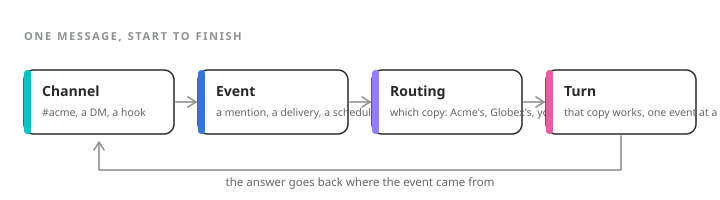

A **channel** in the docs is any place a worker operates. For Slack, the thing underneath is a **channel mapping** (the API's `channels` resource): a record that says which client a Slack channel belongs to, or that it is one of your own. Routing is the code that reads those records.

<Frame caption={"A message in a channel becomes an event, the event is routed to one copy of a worker, and that copy takes a turn."}>
  
</Frame>

## The rule, in order {#rule}

| Question | Answer |
| --- | --- |
| Is this Slack channel mapped to a client? | That client's copy of the worker. |
| Is it a direct message from someone bound to a client? | Their client's copy. |
| Is the sender one of your company's own people? | Your team's copy. |
| Anyone else | One sentence saying it cannot help here, and no worker runs. |

The questions are asked in that order, and the first yes decides. No model is consulted. Which client a turn is about is therefore fixed by which copy runs it, never by anything in the message.

## A mapping is a decision {#mappings}

A channel is mapped to a client, or marked internal. Both are explicit records. A channel with no mapping at all routes nowhere, and is not treated as internal. Moving a channel that is already mapped to one client onto another has to be confirmed, so a re-point is always something you asked for twice.

Direct messages are never mapped. A DM routes by who is in it, through that person's binding to a client. That is one route to the answer rather than two, so there is nothing to disagree.

## Dispatch {#dispatch}

Once the copy is chosen, the message is signed and sent to that copy's sandbox, which has its own key. The reply comes back as a stream of pieces (text, a progress step, a request to send a message) and is posted to Slack by the platform, never by the copy. A copy never holds a Slack token.

A message that arrives while that copy is busy is queued and handled next. A run of messages from one sender is folded into one turn; messages from two senders are two turns.

<Note>
  **Worth knowing.** Routines, webhooks, and a task's log changing start turns the same way: the platform decides which copy, then dispatches. A routine for Acme fires on Acme's copy, and a webhook aimed at an Acme channel is refused if that channel is ever re-mapped to someone else.
</Note>
