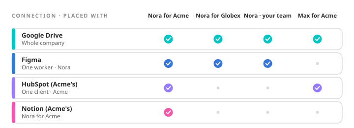

A **connection** in the docs is a credential your company holds and a record of who may use it. Underneath, the credential sits in a **vault** and is used by an **egress gateway**: a proxy every copy of every worker sends its outbound traffic through.

## The placeholder {#placeholder}

When a copy of a worker calls an API, it does not send the key. It sends the literal word `egress-managed` where the key would go. The gateway matches the request's hostname against the connections placed within that copy's reach, swaps the placeholder for the real secret, and forwards the request. The secret exists in the vault and on the wire to the vendor, and nowhere in between.

```text "A call from inside a worker's sandbox"
# What the worker sends. The gateway replaces the placeholder in place,
# keeping whatever scheme surrounds it.
curl -sS "https://api.example.com/v1/me" \
  -H "Authorization: Bearer egress-managed"
```

## Reach {#reach}

A connection is placed with the company, one worker, one client, or one worker for one client. The gateway resolves the narrowest placement that matches. Acme's accounts, placed with Acme, are injected only into Acme's copy; Globex's copy cannot see that they exist. A connection with no placement is inert.

<Frame caption={"Four placements. The narrowest one that matches the copy and the hostname is the one the gateway uses."}>
  
</Frame>

## Nothing comes back out {#never-back}

No API response ever contains a stored secret, on create, on read, or after a rotation. Reading one back in the clear is a browser-only act by a person on the Connections page, and it is recorded against their name. Connecting an account that needs a sign-in hands you a link to open; nothing exists until the consent finishes.

## Connected apps {#apps}

Apps from the catalog, and tool servers, work through a tool platform rather than the gateway: the account's token is held there, and a copy calls the app through control, which signs the call with the copy's own key. The same placement rules decide who may use it, and the copy still never sees the token.

<Note>
  **Worth knowing.** The platform API key a worker uses to call Ergoly itself is held the same way. It is placed at one worker's tier and injected by hostname, which is why the API answers on its own host: a call to control's own address would bypass the gateway and arrive with no credential.
</Note>
