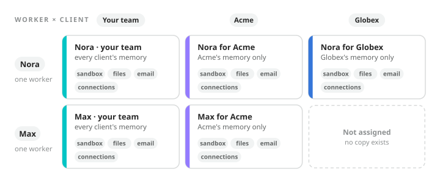

Put your workers down one side and your clients across the top, with a column for your own team. Every cell where a worker is assigned to a client is a separate copy of that worker. It is not a setting on the worker or a filter on what it may see. It is its own running agent, with its own sandbox, its own memory, its own files, its own email address, and whatever connections have been placed within its reach.

<Frame caption={"Nora serves Acme and Globex, so there are three copies of Nora. Max serves only Acme, so there are two of Max. A cell appears when you assign the worker to the client."}>
  
</Frame>

## Each cell is its own agent {#cells}

A cell is what the API calls an **ework**. Each one has:

- **A sandbox.** Its own file system, its own access to the web, and its own key. Nothing another copy writes is visible here.
- **Memory.** A client's copy holds that client's folder, the worker's own knowledge and the company's, and nothing of any other client's. Your team's copy holds every client's folder.
- **An email address.** Nora's reads `nora@youragency.ergoly-mail.com`; Acme's copy has its own, with the client's name in it.
- **Connections**, decided by placement. A connection placed with one worker for one client reaches one cell. Placed with a client, it reaches that column. Placed with a worker, it reaches that row. Placed with the whole company, it reaches every cell.
- **Its own turns.** A copy handles one message at a time. Two cells run at the same time and never wait for each other. Each sleeps when idle and wakes on its own.

## What a row shares {#rows}

Everything that makes Nora Nora: the name and the Slack app, the role, responsibilities and behaviors you set, and the worker's own folder of knowledge and skills. A lesson about the job, filed in that folder by your team's copy, reaches every cell in the row.

## What a column shares {#columns}

Everything that belongs to the client: Acme's folder, Acme's connections, Acme's contacts and channels. Every worker serving Acme has them, and no worker serving Globex does.

Your team's column is different. Every worker has a team copy, and that copy holds every client's memory. It is the one your own people talk to from an internal channel or a DM, which is why they can ask about any account without switching rooms.

## When a cell exists {#exists}

Assigning a worker to a client creates the cell. Unassigning removes it. There is no other way to make or remove a copy, and the API's `eworks` resource lists them read-only.

<Note>
  **Worth knowing.** Which cell answers a message is decided from the channel and the sender before the worker reads a word. Nothing typed in Acme's channel can reach Globex's cell, and a client channel is never answered by your team's copy, even if the client's copy is down.
</Note>

<Columns cols={2}>
  <Card title={"How a worker runs"} href={"/technical/how-a-worker-runs"}>
    Turns, sleep and wake, and what a copy can do.
  </Card>
  <Card title={"Client separation"} href={"/clients/separation"}>
    What a client's copy can see, and what it cannot.
  </Card>
  <Card title={"Placement"} href={"/work/connections/placement"}>
    Which cells a connection reaches.
  </Card>
  <Card title={"Where knowledge lives"} href={"/technical/where-knowledge-lives"}>
    The five tiers, and why the narrowest one wins.
  </Card>
</Columns>
