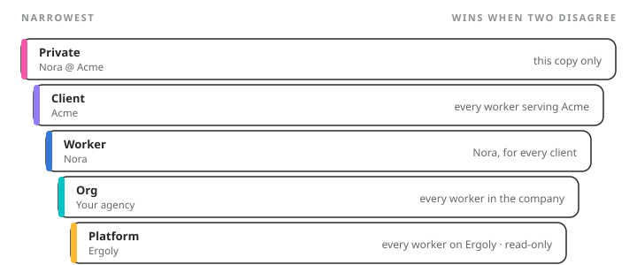

A worker's **knowledge**, its memory and its skills, is a set of Markdown files. The files are held in **tiers** (the API's word too). Four tiers belong to your company; one belongs to Ergoly.

| Docs word | Tier | Belongs to | Who writes it |
| --- | --- | --- | --- |
| One copy's own notes | instance | one running copy of a worker | that copy |
| Client knowledge | client | one client | that client's copy, your team's copy, you |
| Worker knowledge | worker | one worker, across all its clients | any copy of that worker, you |
| Company knowledge | org | your company | you, and your team's copies |
| Platform knowledge | system | Ergoly | Ergoly only; read-only for everyone else |

<Frame caption={"Five tiers. A copy of a worker reaches its own, its client's, its worker's, the company's, and the platform's."}>
  
</Frame>

## Narrowest wins {#narrowest}

When two tiers hold a file with the same name, the narrower tier's file is the one the worker reads. A note about decks in Acme's tier beats a note about decks in Nora's tier, which beats one in the company's, which beats Ergoly's. That is how one client, or one worker, can state an exception without anyone editing the shared text.

The same rule covers skills. A skill of the same name in a narrower tier shadows the broader one. Ergoly's own skills sit at the bottom, so anything you write wins over anything we ship.

## What each copy reaches {#reach}

Acme's copy of Nora mounts four tiers: company, Nora, Acme, and its own. Your team's copy mounts company, Nora, its own, and **every** client's tier, so it can file a fact about Acme in Acme's tier. No copy ever sees another worker's tier, and a client's copy never sees another client's.

## The files {#files}

Each tier has an `always/` folder, whose documents the worker reads in full at the start of every turn, in filename order. A worker's persona, its responsibilities and its behaviors are three such files in its worker tier. Each tier also has a `skills/` folder, where every skill is a directory with a `SKILL.md`. Everything else is indexed and read when the worker needs it.

## Every change is a commit {#git}

Each tier is a private git repository that Ergoly creates and fronts. A change you make in control, through the API, or that a worker makes itself is a commit, and reaches every running copy that mounts that tier within about twelve seconds. Nothing restarts. You can see the history, revert a change, and write the files in any editor.

<Note>
  **Worth knowing.** The `memory` resource in the API is addressed by ework, because which tiers exist depends on which copy you ask about. Read with no tier named and the answer lists the tiers that copy reaches.
</Note>
