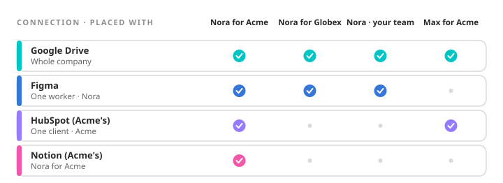

Every connection is placed somewhere, and the placement alone decides which copies of which workers can use it. There is no other switch.

| Placement | Who can use it |
| --- | --- |
| One worker for one client | Only that worker, and only when it is working for that client. The default. |
| One client | Every worker, when it is working for that client. |
| One worker | That worker, for every client and for the company. |
| Whole company | Every worker, everywhere. |

<Frame caption={"Acme's HubSpot, placed with Acme, reaches Nora for Acme and nobody else. The company's Google Drive reaches every copy of every worker."}>
  
</Frame>

## Narrowest wins {#narrowest}

When the same app is connected at two placements, a copy uses the narrowest one that matches it. Acme's own HubSpot, placed with Acme, beats the company-wide HubSpot for Acme's copy of Nora. Globex's copy, with no HubSpot of its own, uses the company's.

## Changing a placement {#changing}

Open the connection and change its access. Before you add, move or remove a placement, control shows who **Gains it**, who **Loses it**, and who **Keeps it**. A connection must keep at least one placement; to take it away from everyone, remove the connection.

On a card, placement reads *Everyone (Company)*, *Nora (Worker)*, *Acme (Client)*, or *Nora for Acme*. A client's page lists the connections that reach that client, marking the ones inherited from the company.

<Note>
  **Worth knowing.** A client's accounts belong with that client. Place them with the client, not the company, and no other client's copy can ever reach them. See [Client separation](/clients/separation).
</Note>
