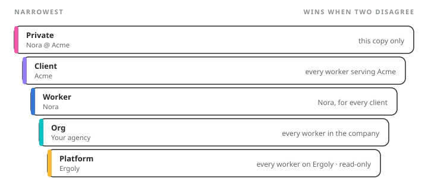

A worker's **knowledge** is two things. **Memory** is what it remembers: facts about clients, preferences, how your agency likes things done. **Skills** are procedures it can run: a saved way of doing a piece of work. Both are plain files, kept in folders that decide who they apply to, and both are on the worker's **Knowledge** tab.

<Frame caption={"Four levels your company owns, and the platform's underneath. A note in a narrower level wins over the same note in a broader one."}>
  
</Frame>

<Columns cols={2}>
  <Card title={"Memory"} href={"/workers/knowledge/memory"}>
    What it remembers, where a note lives, corrections, editing it yourself.
  </Card>
  <Card title={"Skills"} href={"/workers/knowledge/skills"}>
    What one is, where it lives, writing one, workers writing their own.
  </Card>
</Columns>
